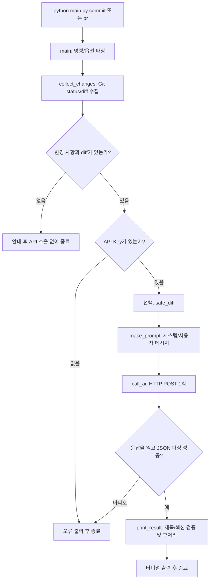

# 구현 해설: 실행 순서대로 따라가기

이 프로젝트는 **Git 변경 내용 → 프롬프트 → HTTP 요청 → JSON 응답 → 사람이 검토할 문장**으로 이어집니다. 코드는 `main.py` 한 파일에 있고, 테스트는 `tests/test_main.py`에 있습니다. 아래 함수 이름을 검색하면서 따라가면 됩니다.

## 1. 전체 실행 흐름

## 2. 데이터가 이동하는 과정

1. **`main(argv=None)`**: `argparse`로 `commit`/`pr`와 `--model`, `--temperature`, `--max-tokens`, `--safe-mode`를 읽습니다. 온도는 0~2, 토큰 상한은 양의 정수인지 확인합니다. 명령이 잘못되면 `argparse`가 사용법을 보여주고 종료 코드 2로 끝냅니다.
2. **`collect_changes()` → `git_output()`**: `subprocess.run`으로 `git status --porcelain`(변경된 파일 목록), `git diff --cached`(스테이징된 변경), `git diff`(스테이징되지 않은 변경)를 실행합니다. 반환값은 `(status, diff)`라는 문자열 두 개입니다. `--no-ext-diff --no-textconv`는 외부 diff 명령과 텍스트 변환을 사용하지 않게 합니다.
3. **`main`의 조기 종료**: `status`가 비면 변경 사항이 없으므로 종료 코드 0으로 끝납니다. `status`는 있는데 `diff`가 비면 새 파일만 있는 경우 등이므로 `git add`를 안내합니다. Git에서 추적하지 않는 새 파일의 **내용은 보내지 않습니다.**
4. **`os.environ.get("AI_API_KEY")`**: 환경변수에서 키를 읽습니다. Key가 없다면 API를 호출하지 않습니다. `--safe-mode`를 켰다면 **`safe_diff()`**에서 diff 일부를 마스킹하고 10개 파일 블록·200줄로 제한합니다.
5. **`make_prompt(command, status, diff)`**: 변경 사실과 출력 규칙을 조합해 `messages = [{"role": "system", ...}, {"role": "user", ...}]`를 만듭니다. `commit`이면 `title`, `pr`이면 `title`, `why`, `what`, `how_to_test`를 가진 **JSON 객체**를 요청합니다.
6. **`call_ai(api_key, model, temperature, max_tokens, messages)`**: 파이썬 dict를 `json.dumps(...).encode("utf-8")`로 바이트로 바꾸고 `urllib.request.Request`로 HTTPS **POST**를 1회 실행합니다. 헤더에는 `Authorization: Bearer ...`, `Content-Type: application/json`이 포함됩니다. 요청에는 `max_completion_tokens`가 전달되며 CLI 옵션명만 `--max-tokens`입니다.
7. **API 응답 처리**: HTTP 응답 JSON의 `choices[0].message.content`를 다시 `json.loads`로 객체로 변환합니다. 정상 완료(`finish_reason == "stop"`)가 아니거나 JSON이 잘못되면 오류로 종료합니다. 인증 오류·연결 오류·응답 형식 오류를 구분합니다. 인증정보가 포함될 수 있는 **서버의 원문 오류 본문은 출력하지 않습니다.**
8. **`print_result(command, result)`**: `one_line_title()`로 제목을 한 줄로 만들고 Commit은 72자, PR은 80자까지 자릅니다. PR은 `bullets()`로 각 배열을 `- ...` 목록으로 변환합니다. 비어 있는 배열에는 **사람이 보완해야 한다는 항목**을 출력합니다. Git 작업을 자동 변경하지 않습니다.

### 함수 관계 빠르게 찾기

| 함수 | 입력 → 출력 | 필요한 이유 |
|---|---|---|
| `git_output` | Git 인수 → stdout 문자열 | Git 실패와 프로그램 실패를 분리 |
| `collect_changes` | 없음 → `(status, diff)` | staged와 unstaged를 모두 반영 |
| `safe_diff` | diff 문자열 → 제한·마스킹 문자열 | 외부 전송 데이터 축소 |
| `make_prompt` | 명령, status, diff → 메시지 목록 | 기능과 출력 양식을 AI에게 지정 |
| `call_ai` | API 설정과 메시지 → Python 객체 | REST 요청·응답 처리 |
| `one_line_title` | 제목, 한도 → 1줄 제목 | 길이 규칙 적용 |
| `bullets` | 섹션 목록, 기본 안내 → Markdown 불릿 | PR 필수 섹션의 최소 구조 유지 |
| `print_result` | 명령과 AI 객체 → 터미널 출력 | 검증·가공 후 사용자 확인 |
| `main` | CLI 인수 → 종료 코드 | 흐름 연결 및 최종 오류 처리 |

## 3. 예외/경계 사례와 설계 이유

- **Git이 없는 경우 / Git 저장소 밖에서 실행**: `git_output`이 실패를 잡아 오류 원인을 표시합니다. 프로그램은 지정한 프로젝트의 루트에서 실행하는 것이 기준입니다.
- **Untracked(신규 파일)만 있는 경우**: 상태에는 `?? new.txt`가 있지만 `git diff`는 파일 내용을 보여주지 않습니다. 이를 근거 없이 AI에게 요약시키지 않고 `git add`를 안내합니다.
- **스테이징한 변경과 하지 않은 변경이 동시에 있을 때**: `git diff --cached`와 일반 `git diff`를 연결합니다. 기본 `git diff`만 쓰면 staged 변경을 놓칠 수 있기 때문입니다.
- **응답이 길거나 형식이 비어 있을 때**: 제목을 최대 길이로 줄이면서 경고합니다. PR 불릿이 없으면 섹션은 유지하되 `수동 보완 필요`로 표시합니다. 반면 제목 자체가 없거나 JSON이 깨졌다면 잘못된 초안을 출력하지 않습니다.
- **API 실패**: 한 번의 요청을 실패했다고 무조건 재시도하지 않습니다. 비용과 중복 요청을 방지합니다. 현재 구현에서는 재시도보다 원인 안내를 선택했습니다.
- **보안 한계**: Safe Mode 정규식은 알려진 모양의 비밀값만 감지합니다. `git status`의 파일명도 프롬프트에 실리므로 Safe Mode를 무조건 안전한 보안 경계로 간주하면 안 됩니다.

## 4. 실제 검증 확인법

`python -m unittest discover -s tests -v`를 실행하면 **임시 Git 저장소에서의 실제 `git` 명령**, Key 누락·에러 처리, HTTP 요청 내용과 호출 횟수(`unittest.mock`), 제목/PR 형식 및 Safe Mode를 검사합니다. 모의 응답을 사용하므로 **외부 API 실제 성공이나 생성 품질을 증명하는 테스트는 아닙니다.**
